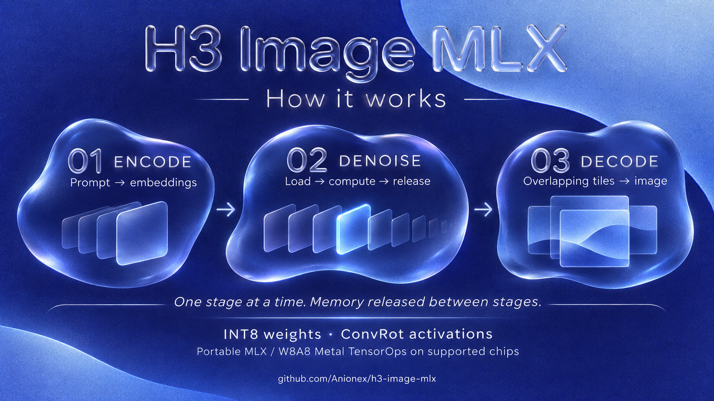
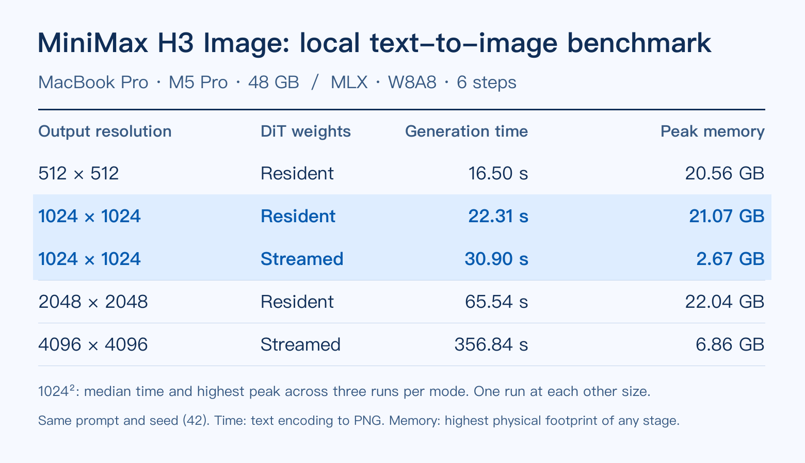

<p align="center"><em>This banner was generated end to end with MiniMax H3 Image using <a href="https://github.com/Anionex/h3-image-mlx">H3 Image MLX</a>.</em></p>

# H3 Image MLX
**English** · [简体中文](README.zh-CN.md)

[](https://x.com/anion_ex)
[](https://pypi.org/project/h3-image-mlx/)
[](pyproject.toml)
[](pyproject.toml)


[Quick start](#generate-your-first-image) · [Image editing](#edit-with-reference-images) · [How it works](#how-it-works) · [Benchmarks](#benchmark-results)

Generate and edit images on an Apple Silicon Mac with MiniMax H3 Image. Optimized for fast inference, with 4K generation using as little as 7 GB of peak inference-process memory. Available through a CLI and Python API, ready to use out of the box.

If you find this repository useful, feel free to 🌟 & fork~

## Highlights

- **Native Apple Silicon inference.** Built on MLX to take advantage of your Mac's compute capabilities, H3 Image runs locally with text-to-image generation and multi-image editing.
- **W8A8 quantization and Metal acceleration.** Reduce weight memory usage with a portable MLX inference path, plus W8A8 Metal TensorOps acceleration on supported chips. Compatible with M1–M4.
- **Staged inference with on-demand block loading.** Each stage runs in a separate process to release its memory on completion. Denoiser weights can be read one block at a time, greatly reducing peak memory usage and leaving more room for other apps.

For reference, in our 1024×1024 generation benchmark, streaming reduced the peak inference-process footprint from **21.07 GB to 2.67 GB**, with median runtime increasing from **22.31 s to 30.90 s**. [Benchmark conditions and results](#benchmark-results)

### Rainy-night watchmaker

[](assets/watchmaker-4096.png)

[Open the original 4096×4096 PNG (22.7 MB)](assets/watchmaker-4096.png?raw=true)

## Generate your first image

Use Python 3.11 or later on a Mac with Metal. Allow 49.30 GB of disk space for a fresh model download. Check the [MiniMax model license](https://huggingface.co/MiniMaxAI/MiniMax-H3-Image/blob/main/LICENSE) for regional and usage restrictions.

```bash
python3 -m venv .venv
source .venv/bin/activate
python -m pip install 'h3-image-mlx==0.1.0a1'

h3-image-mlx fetch --models ./models
h3-image-mlx generate --models ./models --output teapot.png \
  --prompt 'A yellow enamel teapot and a white cup on a blue wooden table.'
```

This writes a 1024×1024 RGB PNG. Set `--width` and `--height` to change the size. Each dimension accepts multiples of 32 from 256 through 4096.

## Edit with reference images

To replace the cup in `teapot.png` with a bird from your own photo, save the photo as `bird.png`. Number the pictures in your prompt in the order you pass them on the command line.

```bash
h3-image-mlx generate --models ./models --output edit.png \
  --reference teapot.png --reference bird.png \
  --prompt 'Edit <Picture 1>. Replace the white cup with the bird from <Picture 2>. Keep the teapot and table.'
```

You can pass up to 16 references. On an M5 Pro, we completed one- and two-reference edits. The 16-reference test reached the third of six denoising steps before cancellation. [Validation notes](VALIDATION.md)

## Python

`generate` returns a Pillow image. Pass reference paths in a list, in the same order as in the CLI.

```python
from h3_image_mlx import generate

image = generate(
    "Replace the cup in <Picture 1> with the bird from <Picture 2>.",
    models="./models",
    references=["teapot.png", "bird.png"],
    seed=42,
    dit_mode="stream",
)
image.save("edit.png")
```

## Reuse existing weights

Point `--models` at a directory with this layout. Symlinks work.

```text
diffusion_models/minimax_h3_image_pruned_int8_convrot.safetensors
text_encoders/qwen3vl_32b_minimax_h3_int8_convrot.safetensors
vae/minimax_h3_image_vae_fp16.safetensors
vae/config.json
tokenizer.json
```

`fetch` checks existing files and downloads missing ones from ModelScope. If you already have the three weight files and tokenizer, it downloads just the 1,826-byte VAE configuration. For Hugging Face, add `--source huggingface`. To check the files against the [SHA-256 manifest](src/h3_image_mlx/weights.json), run `h3-image-mlx verify --models ./models`.

## How it works

The pipeline reduces memory use at three levels: between model stages, within the denoiser, and during image decoding.



- **Run one stage at a time.** Text encoding, denoising and VAE decoding run in separate processes. Each saves its intermediate output and exits before the next loads its weights, so the three models do not need to stay in memory together. Editing adds a reference-image VAE encoding stage before denoising.
- **Keep quantized projections compact.** The runtime reads Comfy-Org's INT8 ConvRot weights directly. Activations are rotated and dynamically quantized to INT8 before quantized linear projections. Supported chips use W8A8 Metal TensorOps; the portable backend evaluates the same quantized projections with tiled standard MLX operations. Other operations retain their appropriate floating-point precision.
- **Load denoiser weights as needed.** In `stream` mode, tensors are read from safetensors as each transformer block runs, rather than cached for all six steps. Denoising still operates on the full image's latent sequence. `resident` mode caches weights to reduce repeated reads. The runtime also precomputes the steps' AdaLN modulation values from the compressed curves in Comfy-Org's pruned checkpoint, then releases the setup weights.
- **Decode in overlapping tiles.** The VAE decodes small groups of latent tiles and blends their overlapping edges into the output image, limiting decoder working memory at high resolutions.

Streaming trades additional weight reads for a smaller memory footprint. Peak usage still includes activations, attention buffers and image buffers, so resolution and reference-image count matter. See the [benchmark results](#benchmark-results) for the measured trade-off.

## Hardware and memory

| Chip | Default compute backend | Hardware tests |
| --- | --- | --- |
| M5 family | W8A8 Metal TensorOps | Text-to-image, single- and two-reference edits on M5 Pro (48 GB) |
| M1–M4 | Portable MLX (experimental) | Portable backend exercised on M5 Pro. M1–M4 tests pending. |
| M6 family | W8A8 Metal TensorOps | Pending |

Text encoding, six-step denoising and image decoding each run in a separate process that releases its weights on exit. Editing adds a VAE encoding stage for the references.

Apple Silicon shares memory between the CPU and GPU. To leave room for other apps, add `--dit-mode stream` to read the denoiser weights one block at a time. With memory to spare, use `--dit-mode resident` to keep weights between steps and cut generation time. The default, `auto`, streams on the portable backend, below 32 GiB of system memory, or above 8,192 packed token positions.

To compare compute backends on an M5 Pro, run the same prompt with `--backend w8a8` and `--backend portable`. See the [validation notes](VALIDATION.md) for settings and pixel comparisons.

### Benchmark results



We used the same teapot prompt, seed 42 and six steps for this table. The 1024×1024 rows report the median time and highest process peak across three runs per mode. Each other row records one run. The 4096×4096 row (356.84 s, 6.86 GB) is the teapot run. Times include text encoding through PNG output.

On the M5 Pro (48 GB), the six 1024×1024 outputs matched pixel for pixel across the two loading modes. The separate 4096×4096 watchmaker example took 6 min 10 s. Its peak inference-process footprint was 6.88 GB.

## Credits and licenses

MiniMax developed [H3 Image](https://huggingface.co/MiniMaxAI/MiniMax-H3-Image) and supplies the [VAE configuration](https://huggingface.co/MiniMaxAI/MiniMax-H3-Image/blob/492fd8c4eca666f1085f57e30738c1e0d86b3439/vae/config.json). [Comfy-Org](https://huggingface.co/Comfy-Org/MiniMax-H3-Image) provides the quantized weights. The three W8A8 Metal kernel files come from [mlx-serve](https://github.com/ddalcu/mlx-serve/tree/9191fbdf697df333cac19ec7a93eaa1098ce3ad5/src/kernels) and retain their [MIT license](src/h3_image_mlx/kernels/LICENSE). This project’s runtime code uses [Apache-2.0](LICENSE).
