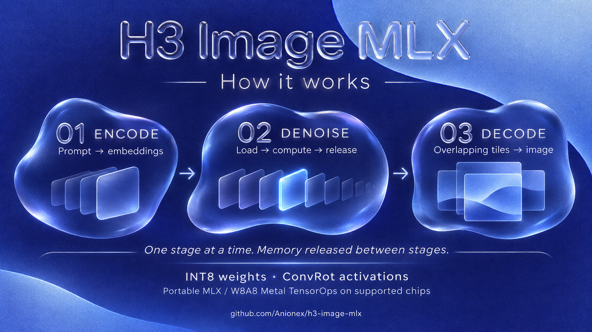

<p align="center"><em>这张头图通过 <a href="https://github.com/Anionex/h3-image-mlx">H3 Image MLX</a> 项目调用 MiniMax H3 Image 端到端生成。</em></p>
<p align="center">如果这个仓库对你有用，欢迎 🌟 &amp; fork~</p>

# H3 Image MLX

[English](README.md) · **简体中文**

[](https://x.com/anion_ex)
[](https://pypi.org/project/h3-image-mlx/)
[](pyproject.toml)
[](pyproject.toml)

[快速开始](#生成第一张图) · [参考图编辑](#用参考图编辑) · [推理原理](#推理原理) · [实测数据](#实测数据) · [使用指南](docs/USAGE.zh-CN.md) · [性能调优](docs/PERFORMANCE.zh-CN.md)

在 Apple Silicon Mac 上用 MiniMax H3 Image 生图、编辑图片。优化本地推理速度，以约 7 GB 的推理进程峰值内存生成 4K 图像；提供命令行和 Python API，开箱即用。

## 亮点

- **Apple Silicon 原生推理。** 基于 MLX，充分利用 Mac 算力，在 Mac 本地运行 H3 Image，支持文生图和多图编辑。
- **W8A8 量化与 Metal 加速。** 降低权重内存占用，提供通用 MLX 推理路径，并在支持的芯片上使用 W8A8 Metal TensorOps 加速。M1–M4 兼容。
- **分阶段推理，按需分块加载。** 各阶段通过独立进程释放内存，去噪权重可逐块读取，大大减少峰值内存占用，为其他应用留出更多内存。
- **分块预读，读取与计算重叠。** GPU 计算当前块时提前读取下一块权重，在保持低内存占用的同时减少等待。[开启预读与异步计算](#推荐开启分块推理加速)

作为参考，在 1024×1024 同机实测中，开启两个开关的分块推理**与常驻速度基本持平**：**23.61 秒 vs 23.63 秒**，实测最高进程峰值从 **21.18 GB 降至 3.23 GB，减少约 85%**，输出逐像素一致。[测试条件与完整数据](#分块推理达到常驻速度)

### 实测数据

#### 分块推理达到常驻速度

M5 Pro 48 GB，`0.1.0a3`，1024×1024，相同权重、提示词和 seed，原版六步采样，不使用编码缓存。

| 模式 | 整图耗时中位数 | 实测最高进程峰值 |
| --- | ---: | ---: |
| 常驻 | 23.63 秒 | 21.18 GB |
| 普通分块 | 32.33 秒 | 2.53 GB |
| **分块＋预读＋异步** | **23.61 秒** | **3.23 GB** |

<sub>常驻和预读＋异步各测五轮，普通分块三轮，预热不计入。内存取正式轮次内核记录的最高进程 physical footprint，单位为十进制 GB。[完整数据与耗时范围](BENCHMARKS.md#streaming-prefetch-and-async) · [原始 JSON](benchmarks/controlled/2026-11-12-prefetch/summary.json)</sub>

#### 同机受控对比

同一台 M5 Pro MacBook（48 GB），使用同一份权重、茶壶提示词、初始噪声和六步时间表；每组预热一次，正式测量三次。

| 分辨率 | MLX DiT 模式 | ComfyUI 耗时（秒） | MLX 耗时（秒） | 速度倍数 | ComfyUI 峰值（GB） | MLX 峰值（GB） |
| --- | --- | ---: | ---: | ---: | ---: | ---: |
| 1024×1024 | `resident` | 87.15 | 19.90 | **4.38×** | 31.29 | 21.16 |
| 1024×1024 | `stream` | 87.15 | **28.82** | **3.02×** | 31.29 | **2.53** |
| 2048×2048 | `resident` | 134.17 | 57.43 | **2.34×** | 38.21 | 22.27 |
| 2048×2048 | `stream` | 134.17 | **67.06** | **2.00×** | 38.21 | **3.48** |
| 4096×4096 | `stream` | 570.59 | **317.29** | **1.80×** | 42.31 | **7.18** |

<sub>耗时为完整生图请求的三轮中位数。内存为内核记录的单进程 physical footprint 峰值，包含预热，单位为十进制 GB。速度倍数 = 本机 ComfyUI 耗时 ÷ MLX 耗时。</sub>

这是完整管线对比：ComfyUI 默认文本编码使用 CPU，MLX 使用 GPU。主表复现社区配置；另测的原生 INT8 DiT 路径、固定版本与测量方法见[完整实测表](BENCHMARKS.md#controlled-test-setup)，[数据 JSON](benchmarks/controlled/2026-11-11/summary.json) 随仓库提供。

#### 补充：社区独立实测

| 设备 / 内存 | 推理方案 | DiT 模式 | 分辨率 | 耗时（秒） | 进程峰值（GB） | 来源 |
| --- | --- | --- | --- | ---: | ---: | --- |
| <sub>M5 MacBook Air / 16 GB</sub> | H3 Image MLX | `stream` | 1024×1024 | **70.51** | **2.48** | [arielfikru](benchmarks/raw/teapot-1024-m5-air-16gb.json) |
| <sub>M5 MacBook Air / 16 GB</sub> | H3 Image MLX | `stream` | 2048×2048 | **240.78** | **2.78** | [arielfikru](benchmarks/raw/teapot-2048-m5-air-16gb.json) |
| <sub>M5 Pro Mac mini / 64 GB</sub> | ComfyUI + MPS INT8 | — | 1024×1024 | 89.55 | 31.42 | [pratikgx](https://huggingface.co/datasets/pratikgx/minimax-h3-image-m5-pro-mac-mini-bench) |
| <sub>M5 Pro Mac mini / 64 GB</sub> | ComfyUI + MPS INT8 | — | 2048×2048 | 164.90 | 36.21 | [pratikgx](https://huggingface.co/datasets/pratikgx/minimax-h3-image-m5-pro-mac-mini-bench) |
| <sub>M5 Pro Mac mini / 64 GB</sub> | ComfyUI + MPS INT8 | — | 4096×4096 | 547.31 | 48.78 | [pratikgx](https://huggingface.co/datasets/pratikgx/minimax-h3-image-m5-pro-mac-mini-bench) |

<sub>不同机器上的独立测量，保留贡献者原始结果；次数与测量口径见[完整记录](BENCHMARKS.md#supplementary-earlier-and-community-results)。此前 M5 Pro 的单机测试也保留在其中。</sub>

### 生成结果

[](assets/generation-gallery.jpg)

使用 H3 Image MLX 本地生成，展示美食、野生动物、产品摄影、建筑、插画和 4K 修表师人像。点击拼图可查看完整尺寸。

## 生成第一张图

源码版还支持 **未量化的 BF16 DiT 和文本编码器权重**，保留 AdaLN 裁剪和分阶段分块推理。使用 `--precision bf16` 选择，默认仍为 INT8。[BF16 下载与使用](docs/USAGE.zh-CN.md#bf16-权重)

使用支持 Metal 的 Apple Silicon Mac 和 Python 3.11 或更高版本。首次下载模型需要 49.30 GB 磁盘空间。模型的适用地区和使用条件见 [MiniMax 模型许可](https://huggingface.co/MiniMaxAI/MiniMax-H3-Image/blob/main/LICENSE)。

```bash
python3 -m venv .venv
source .venv/bin/activate
python -m pip install 'h3-image-mlx==0.1.0a3'

h3-image-mlx fetch --models ./models
h3-image-mlx generate --models ./models --output teapot.png \
  --prompt 'A yellow enamel teapot and a white cup on a blue wooden table.'
```

默认输出 1024×1024 的 RGB PNG。用 `--width` 和 `--height` 指定宽高，每边可取 256 到 4096 之间的 32 的倍数。

## 推荐开启分块推理加速

**使用 `--dit-mode stream` 时，推荐同时开启权重预读和异步计算，减少加载权重时的等待。两个开关默认关闭。** 原版六步采样保持不变；本次 1024×1024 实测与常驻速度基本持平，进程峰值减少约 85%。[同机实测](#分块推理达到常驻速度) · [贡献者实测](docs/PERFORMANCE.zh-CN.md#贡献者实测)

这些开关从 `0.1.0a2` 开始提供；升级后在单次命令中开启：

```bash
python -m pip install --upgrade 'h3-image-mlx==0.1.0a3'
H3_ASYNC=1 H3_PREFETCH=1 h3-image-mlx generate \
  --models ./models --dit-mode stream --output teapot.png \
  --prompt 'A yellow enamel teapot and a white cup on a blue wooden table.'
```

[使用指南：命令行、Python 与已有权重](docs/USAGE.zh-CN.md) · [性能调优：开关、缓存与性能记录](docs/PERFORMANCE.zh-CN.md)

**实验功能：** GitHub `main` 提供可选的两步／三步 LoRA 推理与预合并 INT8 权重工具，默认关闭。[用法与画质取舍](docs/PERFORMANCE.zh-CN.md#实验性少步数-lora)

## 用参考图编辑

假设要把 `teapot.png` 里的白杯换成自己照片里的鸟，把鸟的照片保存为 `bird.png`。提示词里的 `<Picture 1>` 和 `<Picture 2>` 对应命令行传入参考图的顺序。

```bash
h3-image-mlx generate --models ./models --output edit.png \
  --reference teapot.png --reference bird.png \
  --prompt 'Edit <Picture 1>. Replace the white cup with the bird from <Picture 2>. Keep the teapot and table.'
```

最多可传入 16 张参考图。M5 Pro 已完成单图和双图编辑实测；16 图测试在六步去噪完成第三步后取消。[验收记录](VALIDATION.md)

## 推理原理

管线从三个层面降低内存占用：模型阶段之间分开加载，去噪过程中按需读取权重，图像解码时分块处理。



- **一次运行一个阶段。** 文本编码、去噪和 VAE 解码分别在独立进程中执行，保存中间结果后退出，再由下一阶段加载权重，三个模型无需同时驻留内存。图片编辑会在去噪前增加参考图的 VAE 编码阶段。
- **量化线性层，减少计算与存储开销。** 直接读取 Comfy-Org 的 INT8 ConvRot 权重，激活值经过旋转变换和动态 INT8 量化后参与计算。支持的芯片使用 W8A8 Metal TensorOps；通用后端通过标准 MLX 分块运算计算同样的量化投影。其他运算保留适合各自用途的浮点精度。
- **去噪权重按需读取。** `stream` 模式随着 Transformer 各层执行，从 safetensors 读取所需权重，不把全部权重缓存到六步结束。去噪仍处理整张图的潜空间序列；`resident` 模式则缓存权重，减少重复读取。管线还会根据 Comfy-Org 裁剪权重中的压缩曲线，预计算各步的 AdaLN 调制值，随后释放准备阶段的权重。
- **重叠分块解码。** VAE 每次解码一小组潜空间图块，将重叠边缘融合成完整图片，控制高分辨率下解码阶段的工作内存。

分块推理通过按需读取权重降低内存占用；预读与异步计算让读取和 GPU 计算重叠，减少额外读取带来的耗时。峰值还包含激活值、注意力和图像缓冲区，因此也会随分辨率和参考图数量变化。具体取舍见[实测数据](#实测数据)。

## 硬件与内存

M5/M6 默认选择 W8A8 Metal TensorOps，M1–M4 使用通用 MLX 后端。需要更低内存占用时使用 `--dit-mode stream`，希望在去噪步骤之间保留权重时使用 `--dit-mode resident`。[硬件验证与自动模式选择](docs/PERFORMANCE.zh-CN.md#硬件与内存)

## 文档索引

| 文档 | 内容 |
| --- | --- |
| [使用指南](docs/USAGE.zh-CN.md) | 命令行参数、参考图编辑、Python API 与已有权重 |
| [性能调优](docs/PERFORMANCE.zh-CN.md) | 推荐的分块加速开关、硬件模式、编码缓存与性能分析 |
| [实测数据](BENCHMARKS.md) | 耗时、内存、测试环境与原始 JSON |
| [验收记录](VALIDATION.md) | 已完成检查与待测硬件范围 |

## 致谢与许可

MiniMax 开发了 [H3 Image](https://huggingface.co/MiniMaxAI/MiniMax-H3-Image) 并提供 [VAE 配置](https://huggingface.co/MiniMaxAI/MiniMax-H3-Image/blob/492fd8c4eca666f1085f57e30738c1e0d86b3439/vae/config.json)。[Comfy-Org](https://huggingface.co/Comfy-Org/MiniMax-H3-Image) 提供量化权重。三份 W8A8 Metal 内核源码来自 [mlx-serve](https://github.com/ddalcu/mlx-serve/tree/9191fbdf697df333cac19ec7a93eaa1098ce3ad5/src/kernels)，沿用其 [MIT 许可](src/h3_image_mlx/kernels/LICENSE)。本项目编写的运行时代码采用 [Apache-2.0 许可](LICENSE)。

## 关于作者

我是 [anionex](https://anionex.me/)，一名 AI 原生开发者，曾上榜 GitHub 全球开发者趋势榜第 3 名，总 Star 数超过 18.7k。如果你想了解我后续的更多工作，欢迎在 [X](https://x.com/anion_ex) 或 [GitHub](https://github.com/Anionex) 关注我～
